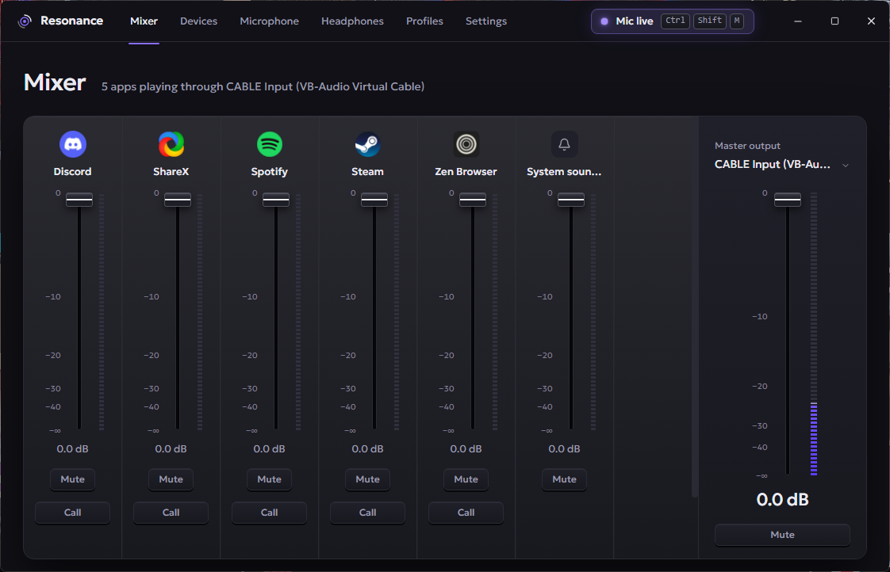
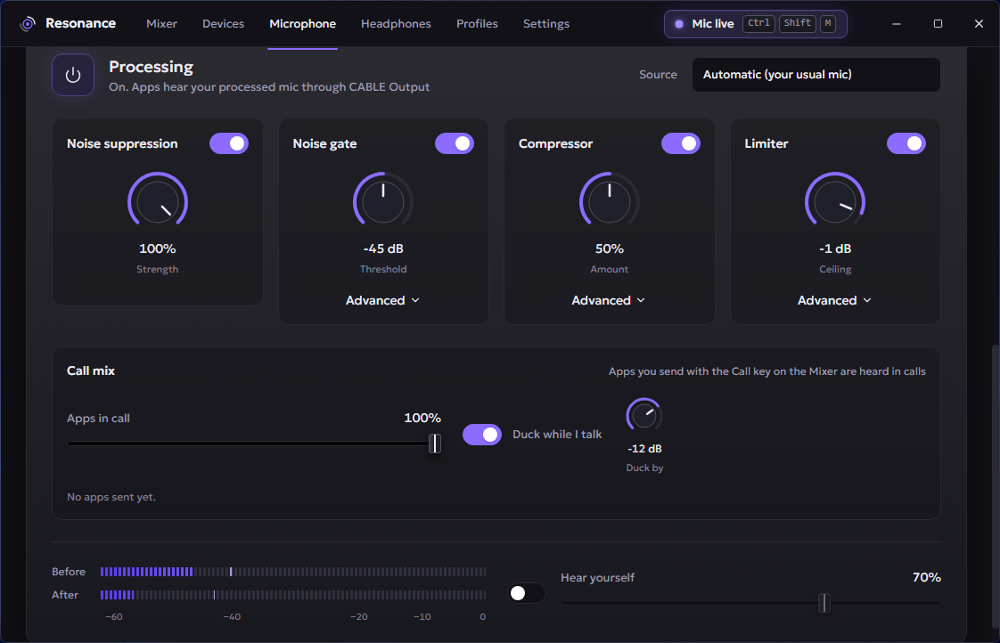
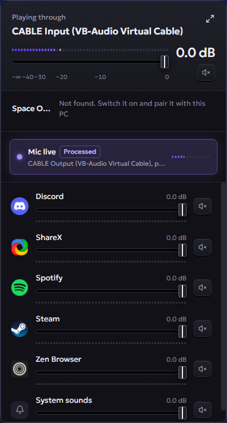

<div align="center">


# Resonance

**A modern audio control centre for Windows.** Per-app volume and routing, a studio-grade processed microphone,
a call mix and headphone control, all from one window or the tray.


[](https://github.com/QuantumForce69/Resonance/releases/latest)

**[⬇ Download for Windows](https://github.com/QuantumForce69/Resonance/releases/latest)**



</div>

## Why Resonance

Voicemeeter is powerful but feels like a mixing desk from 2005. The Windows volume mixer is friendly but can't
clean up your mic or send music into a Discord call. Resonance does the useful parts of both in a modern
interface, and it stays out of the way: in the tray it uses about **1 % of one CPU core and 15 MB of memory**.

## Features

### 🎚️ Mixer
- A fader, live meter and mute for every app playing sound, plus the master output.
- Send each app to a different output device; the route is remembered and re-applied when the app next plays.
- Set the default playback and recording devices from the **Devices** page.

### 🎙️ Processed microphone


- **AI noise suppression** (RNNoise) removes fans, keyboards and background hum.
- **Noise gate**, **compressor** and **limiter**, each with a single main knob and an *Advanced* drawer.
- Every app hears the processed mic through the free [VB-Cable](https://vb-audio.com/Cable/) virtual device.
  Resonance switches the Windows default mic for you and switches it back when processing is off.
- **Hear yourself** monitoring, and *before / after* meters so you can see what each stage is doing.
- A global **mute shortcut** (default <kbd>Ctrl</kbd>+<kbd>Shift</kbd>+<kbd>M</kbd>) that works in fullscreen games,
  in toggle, push-to-talk or push-to-mute mode.

### 📞 Call mix
- Press **Call** on any mixer strip to send that app's sound into your calls (music, a game, a soundboard).
- Each sent app has its own level, and an overall **Apps in call** level.
- **Duck while I talk** lowers the sent apps automatically when you speak.

### 🎧 Headphones
- Soundcore **Space One** control: noise cancelling / transparency / normal, EQ presets and a custom 8-band EQ,
  battery, firmware and serial number.

### 🗂️ Profiles
- Save your setup as a profile, choosing which parts it controls: app volumes and routing, mic processing and
  call sends, headphone mode and EQ, default output. Anything you leave out stays as it is when you switch.
- Switch profiles in one click from the app or the tray.

### 🪟 Tray flyout


- Left-click the tray icon for a compact mixer: master volume, mic status, headphones and every app.
- **Start with Windows** (straight into the tray) and a short **first-run setup**.
- Windows only exist while they're open, so the tray costs almost nothing.

<br clear="right">

### 🎛️ Stream Deck
- A **Mic Mute** key for Elgato Stream Deck that shows the real state: green when you're live, red when muted,
  grey when Resonance isn't running. It stays in sync however you mute (keyboard shortcut, tray or profile).
- Install it with `powershell -File streamdeck\install.ps1` (needs Rust), then drag **Resonance → Mic Mute**
  onto a key. Companion apps talk to Resonance over the local pipe `\\.\pipe\resonance`
  ([protocol](src-tauri/src/app/control.rs)).

## Performance

Measured on the same PC with the same apps open, as a percentage of one CPU core:

| | Resonance (tray) | Resonance (window open) | Voicemeeter (tray) |
|---|---|---|---|
| CPU | 0.4–1.1 % | 6 % | 0.7 % |
| Private memory | 13–16 MB | 137 MB | 15 MB |
| Processes | 1 | 1 + WebView2 | 1 |

The whole microphone chain (noise suppression, gate, compressor and limiter) costs about 5 ms of CPU per second of
audio. The audio thread runs at "Pro Audio" priority and never allocates memory.

## Requirements

- Windows 10 or 11 (64-bit) with the [WebView2 runtime](https://developer.microsoft.com/microsoft-edge/webview2/)
  (preinstalled on Windows 11).
- [VB-Cable](https://vb-audio.com/Cable/) (free) for the processed microphone and call mix. Everything else works
  without it, and the first-run setup links to it.
- A Soundcore Space One, paired over Bluetooth, for the Headphones page (optional).

## Install

1. Download `Resonance_0.1.0_x64-setup.exe` from the [latest release](https://github.com/QuantumForce69/Resonance/releases/latest).
2. Run it. The installer isn't code-signed, so Windows SmartScreen may warn you:
   choose **More info → Run anyway**.
3. Follow the first-run setup. Resonance lives in the tray; left-click it for the flyout, right-click for the menu.

Settings, profiles and logs are stored in `%APPDATA%\Resonance`.

## Build from source

Prerequisites: [Node.js](https://nodejs.org/) 20+, [Rust](https://rustup.rs/) (stable, MSVC toolchain) and the
Visual Studio C++ Build Tools.

```powershell
npm.cmd install
npm.cmd run tauri dev      # run with hot reload
npm.cmd run tauri build    # installer → src-tauri/target/release/bundle/nsis/
```

Quit an installed copy of Resonance before running a development build: both want the same tray icon,
hotkeys and audio devices.

### Tests

```powershell
npm.cmd test                                                  # frontend (Vitest)
cd src-tauri; cargo test --lib                                # Rust logic and DSP
cd src-tauri; cargo test --test wasapi -- --ignored           # real audio hardware
cd src-tauri; cargo test --test engine_hw -- --ignored        # processed mic and call mix, needs VB-Cable
```

The hardware tests use your real devices and play short test tones.

## How it works

```
src/                  React 19 + TypeScript + Tailwind UI (main window, tray flyout)
src-tauri/src/
  app/                Tauri setup, commands, windows and tray
  app_state/          the controller: settings, profiles, processing, call sends
  engine/             real-time audio: DSP chain, call bus, ducker, resampling and drift correction
  win/                Windows APIs: WASAPI sessions and endpoints, process loopback, start-up shortcut
  headset/            Soundcore Space One over Bluetooth (via OpenSCQ30)
streamdeck/           Stream Deck plugin (Rust): the Mic Mute key
docs/superpowers/     design specs and implementation plans for each phase
```

- **Mixer state** is event-driven: Windows notifies Resonance of new sessions and volume changes, so nothing is
  polled while the app sits in the tray.
- **The processed mic** captures your microphone with WASAPI, runs it through the DSP chain and plays it into
  VB-Cable's input; apps record from VB-Cable's output. A PI-controlled resampler absorbs the clock drift between
  the two devices.
- **The call mix** captures individual apps with Windows' per-process loopback and mixes them into the processed
  mic.

## Credits

- [OpenSCQ30](https://github.com/oppzippy/OpenSCQ30): Soundcore headphone protocol
- [nnnoiseless](https://github.com/jneem/nnnoiseless): Rust port of Xiph's [RNNoise](https://github.com/xiph/rnnoise)
- [rubato](https://github.com/HEnquist/rubato): resampling
- [VB-Cable](https://vb-audio.com/Cable/) by VB-Audio: the virtual audio device
- [Tauri](https://tauri.app/), [windows-rs](https://github.com/microsoft/windows-rs), [React](https://react.dev/)
  and [Zustand](https://github.com/pmndrs/zustand)

## Licence

GPL-3.0, because Resonance uses OpenSCQ30. See [LICENSE](LICENSE).
